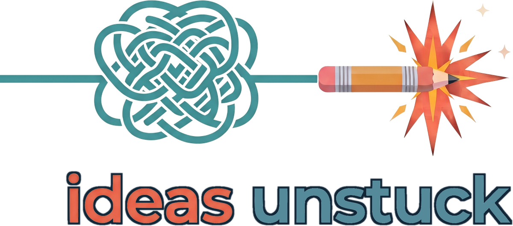

<p align="center">
  
</p>

# Ideas, Unstuck

**Every gadget needs a real reason.**

The build notes behind the video series *Ideas, Unstuck* on [@workFLOw42](https://www.youtube.com/@workFLOw42) —
the real story of how our home learned to think along: smart speakers that became a story box for kids
(no phone needed), a randomizer for audio books, silent wake-up, school info in one place, solar curtains
that charge when the sun actually hits the window, kids helping to build their own controllers, and
3D-printed figures.

> 🚧 **Work in progress.** The series is in production; this repo grows with it.

## Three ideas behind everything

1. **Every gadget needs a real reason.** Having it is nice. Using it for something that matters is the point.
2. **The data is usually already there.** Find the API or an existing integration, fetch it, process it.
   The portal doesn't matter — the idea does.
3. **Idea: human. Code: AI. Checked: human.** I last wrote code at university. Everything here was built
   with the help of AI — and only kept when it really worked.

## Watch the series

▶️ **YouTube:** [Ideas, Unstuck — the playlist](https://www.youtube.com/playlist?list=PLeLg2Pkrl_X4) · channel [@workFLOw42](https://www.youtube.com/@workFLOw42)

## Structure — example code per episode

Each episode gets its own folder with a short guide and the example code shown in it —
always two ways: **build it yourself** and **build it with AI**.

```
episodes/
  00-trailer/
  01-my-smart-home-wasnt-smart/
  02-one-system-instead-of-five-apps/
  03-the-first-chip/
  04-the-randomizer/
  …
shared/          building blocks used by several episodes (blueprints, ESPHome packages, secrets.yaml.example)
3d/              printable cases (STL/3MF)
```

No videos in this repo — only guides and code. Everything is cleaned up: no real credentials, IDs,
addresses or anything that points to a real home.

## Built with

- [Home Assistant](https://www.home-assistant.io) · [ESPHome](https://esphome.io)
- [adonno/tagreader](https://github.com/adonno/tagreader) — the NFC reader that started it all
- [M5Stack](https://m5stack.com) modules (LEGO Technic compatible, plug-and-play)
- My own integrations: [DSB_Mobile_Api](https://github.com/workFLOw42/DSB_Mobile_Api) · [Elternportal_API](https://github.com/workFLOw42/Elternportal_API) · [ha-deutsche-ferien](https://github.com/workFLOw42/ha-deutsche-ferien)

## More of my projects

Same idea, different places: a real problem first, then my own tool for it.

**Home Assistant integrations**
- [DSB_Mobile_Api](https://github.com/workFLOw42/DSB_Mobile_Api) — school substitution plans in Home Assistant
- [Elternportal_API](https://github.com/workFLOw42/Elternportal_API) — school letters, appointments and timetables from the parents' portal
- [ha-deutsche-ferien](https://github.com/workFLOw42/ha-deutsche-ferien) — German school holidays and public holidays for all 16 states

**Apps**
- [MeineNoten](https://github.com/workFLOw42/MeineNoten) — sheet music on a tablet, pages turned with a Bluetooth foot pedal, so both hands stay on the guitar
- [workFLOw01](https://github.com/workFLOw42/workFLOw01) — a minimal analog watch face for Wear OS with moon phases

**3D printing** (parametric, OpenSCAD)
- [3D_Cable_box](https://github.com/workFLOw42/3D_Cable_box) — cable box with removable Voronoi walls and a sliding lid
- [3D_OralB_Sonicare_toothbrush_holder](https://github.com/workFLOw42/3D_OralB_Sonicare_toothbrush_holder) — holder for electric toothbrushes with exchangeable inserts

**Games**
- [flightsimulator](https://github.com/workFLOw42/flightsimulator) — a small flight simulator built for my kids

All public projects: [github.com/workFLOw42](https://github.com/workFLOw42)

## License

Code: [MIT](LICENSE). 3D files in `3d/`: [CC BY-NC 4.0](https://creativecommons.org/licenses/by-nc/4.0/) (see `3d/LICENSE.md` once added).
